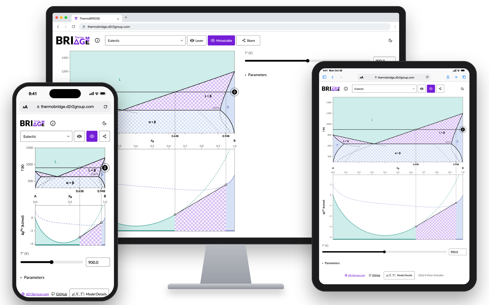

<h1>
  <picture>
    <source media="(prefers-color-scheme: dark)" srcset="assets/logo-dark.svg" />
    
  </picture>
</h1>

ThermoBRIDGE (**B**inary **R**egular-solution **I**nteractive **D**iagram
**G**enerator for **E**ducation) is an interactive $T$-$X$ phase diagram of a
binary system A-B whose liquid and solid are regular solutions, optionally with
an intermediate compound, with the Gibbs energy curves at one temperature
plotted underneath, for teaching MATL7355.



The cut is a horizontal line at $T^*$ across the diagram. The panel below plots
$g$ of every phase at $T^*$, on the same $X_B$ axis, with the common tangents
of their lower convex envelope, so each two-phase field is visibly a tangent
line. One-phase fields are shaded in the phase's color and two-phase fields in
a checkerboard per kind of field, and the panel repeats that shading under the
envelope. Dotted lines join each tangent point to the boundary above it, and
its $X_B$ is written in bold under the diagram.

## Using it

- **System** picks one of 20 presets in five groups, or **Custom**, which
  opens **Parameters**.
- **ⓘ**, beside the logo, opens a short overview of the app and of every
  button; the **moon/sun** switches the theme.
- **Move the cut** by dragging its line or handle, with the slider or number
  field, or with the keyboard on its handle. Clicking the **logo** snaps it to
  the next stable invariant (eutectic, peritectic, monotectic, …).
- **Lever** puts a knob at the overall composition $X_0$ on the cut. In a
  two-phase field the tie line is drawn bold with each phase's share; $X_0$
  stays put while the cut moves, so moving it traces a cooling path.
- **Metastable** shows or hides the boundaries carried past each invariant
  (dashed), the spinodals (dotted) and the curves off the envelope.
- **Parameters** edits $\alpha_\mathrm{l}$ and $\alpha_\mathrm{s}$, the
  components ($T_\mathrm{m}$, $\Delta s$), an intermediate compound (a line
  compound or one with a range) and the window (fitted automatically while
  **auto** is ticked). Edits take effect on **Apply**, and only if they pass
  the validity checks.
- **Export** / **Import** save and load a system as JSON; **Share** makes a
  link that opens the same system, cut and lever (e.g. `#h;T,700;X,.3`).
- **Model Details**, in the footer, shows the model's equations, the presets,
  the limits and the numerics.

## Model

With the pure liquids as reference and constant entropies of fusion, the pure
solids lie at $\Delta g^\circ_i = \Delta s_i (T - T_{\mathrm{m},i})$, and each
phase is a regular solution,

$$g_\mathrm{s} = (1 - X)\,\Delta g^\circ_A + X\,\Delta g^\circ_B + \alpha_\mathrm{s} X(1 - X) + RT\,[X \ln X + (1 - X) \ln(1 - X)],$$

and likewise $g_\mathrm{l}$ without the $\Delta g^\circ$ terms, with
$X = X_B$ and $\alpha$ independent of $T$; $\alpha > 0$ gives a miscibility
gap below $T_c = \alpha/2R$. An intermediate compound at $X_c$ lies
$\Delta h_f - T\Delta s_f$ below the pure solids' line, as a point (line
compound) or as a third regular solution with $\alpha_\gamma < 0$ (range). The
stable state is the lower convex envelope: phases in equilibrium share a
tangent, and three share one at an invariant. The panel plots
$\Delta g^{M,r} = g - r$, with $r$ the line through the lower pure phase at each
end, which keeps every tangent, on an axis fitted to $T^*$.

Every preset has $T_{\mathrm{m},A} = 800$ K and
$\Delta s_A = \Delta s_B = 10$ J/(mol·K):

| Group | Presets | $\alpha_\mathrm{l}$, $\alpha_\mathrm{s}$ (kJ/mol) |
|---|---|---|
| Ideal solutions | Ideal lens | 0, 0 |
| Complete solid solubility | Lens with a melting dip / peak | ∓10, 0 |
| Solid miscibility gap | Melting dip over a solid gap; **Eutectic** (default), wider gap; three peritectics | −15 to +20, +6 to +30 |
| Liquid miscibility gap | Eutectic and monotectic; peritectic and monotectic; syntectic | +20 to +30, +15 to +30 |
| Intermediate compound | Congruent, incongruent and Berthollide compounds; eutectoid; peritectoid; syntectic with a compound; dissolving compound; metatectic | 0 to +30, 0 to +15 |

The presets and 18 more $(\alpha_\mathrm{l}, \alpha_\mathrm{s})$ pairs agree
with [pycalphad](https://pycalphad.org/) 0.11.2 to $10^{-3}$ in the phases
around each event and the tie-line compositions (November 2026). Limits:
without the compound every invariant involves the liquid; there is at most one
compound, with no sublattice model; with equal entropies of fusion a
peritectic stays within about 100 K above $T_{\mathrm{m},A}$; metastable
miscibility domes are not drawn.

## Development

Needs Node 22.13+, 24 or 26+; CI uses [.nvmrc](.nvmrc).

```sh
npm ci
npm run dev           # local server with reload
npm test              # Vitest unit tests
npm run build         # static site in dist/
npm run test:e2e      # Playwright against the built site (build first)
npm run lint          # ESLint
npm run format:check  # Prettier
npm run typecheck     # tsc --noEmit
npm run math          # re-render the Model Details formulas after editing them
npm run mockup        # re-render assets/mockup.png (build and preview first)
uvx --with pycalphad python scripts/crosscheck.py   # cross-check against pycalphad
```

The first Playwright run needs `npx playwright install chromium`. The physics
is in [src/physics/](src/physics/) (no dependencies) and the interface in
[src/ui/](src/ui/), drawn with D3. The Model Details formulas are TeX in
[src/ui/modelDetails.ts](src/ui/modelDetails.ts), pre-rendered to SVG with
MathJax into the committed [src/assets/math.json](src/assets/math.json); a test
fails while it is out of date. The logo's master is
[assets/logo-light.svg](assets/logo-light.svg); the dark, inline
([src/assets/logo.svg](src/assets/logo.svg)) and icon
([public/favicon.ico](public/favicon.ico)) copies follow it, and a test checks
that the three SVGs match. [CI](.github/workflows/thermobridge.yml) runs
every check on each push and pull request and deploys `main` to GitHub Pages.

## Development note

Claude Opus 5.5 (Anthropic) was used in developing this app, in close iteration
under the author's supervision.

## License

ThermoBRIDGE is released under the MIT License; see [LICENSE](LICENSE). Bundled
fonts and outlines keep their own licenses: Lato, also in the logo (SIL Open
Font License), and MathJax's TeX fonts in the formulas (Apache License 2.0).
